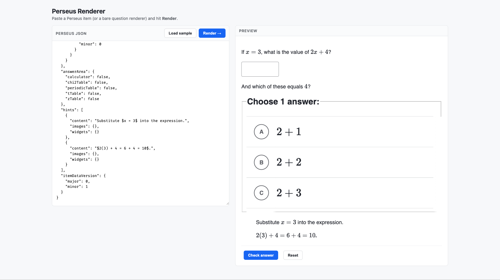

# Perseus Renderer

A tiny web app that renders [Khan Academy Perseus](https://github.com/Khan/perseus)
exercise JSON. Load a `.json` file containing a Perseus item (or an array of
items) and interact with each one in a two-column grid — including a **Check
answer** button that scores your input.



## Run it

```bash
cd web
npm install
npm run dev
```

Then open http://localhost:5180.

```bash
npm run build     # production build into dist/
npm run preview   # preview the production build
```

> Requires Node 18+. The Khan Academy packages pin React to exactly `18.2.0`,
> so this app does too.

## What it accepts

Click **Choose .json file…** to load a file. The file can contain either a
single object or an array of objects, and each object can be either shape:

- **A full Perseus item** — `{ "question": {...}, "answerArea": {...}, "hints": [...] }`
- **A bare renderer** — just the `question` part: `{ "content": "...", "widgets": {...}, "images": {} }`
  (it gets wrapped into an item automatically).

Every item in the file is rendered as its own interactive card in a two-column
grid. Click **Load sample** (or just open the app) to load
[`public/items.json`](public/items.json), an example array of four items.

## How it's wired

The interesting bits, and why each is needed:

| File | Responsibility |
|------|----------------|
| [`src/main.tsx`](src/main.tsx) | Loads CSS (Perseus + Wonder Blocks tokens + MathJax), calls `init()` to register widgets, sets global `Dependencies`, and wraps the app in `<RenderStateRoot>`. |
| [`src/perseus-deps.tsx`](src/perseus-deps.tsx) | The `PerseusDependencies` (V1 + V2) objects Perseus requires, modeled on Perseus's own test harness but with a real MathJax `TeX` component. |
| [`src/tex.tsx`](src/tex.tsx) | Real math rendering via `@khanacademy/mathjax-renderer`. |
| [`src/PerseusItemRenderer.tsx`](src/PerseusItemRenderer.tsx) | Wraps `<ServerItemRenderer>` with the i18n context, the keypad context (for math-input widgets), and a Check/Reset UI that scores via `scorePerseusItem`. |
| [`src/App.tsx`](src/App.tsx) | The file picker + two-column grid of item cards. Reads the chosen `.json` file, normalizes a single item or an array into a list, and renders one `PerseusItemRenderer` per item. |
| [`src/shell.ts`](src/shell.ts) | The bridge to a native shell (see below). No-ops in a plain browser. |

### Gotchas worth knowing (these took the most digging)

- **`Dependencies.setDependencies(...)` must be called once at startup**, and
  `<ServerItemRenderer dependencies={...}>` also needs the V2 deps.
- **`<PerseusI18nContextProvider strings={mockStrings} locale="en">`** is
  required, or the renderer throws `Cannot read properties of null (reading
  'strings')`. `mockStrings` comes from the `@khanacademy/perseus/strings`
  subpath.
- **`@khanacademy/wonder-blocks-tokens/styles.css` + `<RenderStateRoot>`** are
  both required, or Wonder Blocks components (e.g. the numeric input, radio
  choice layout) render unstyled/broken. Wonder Blocks now themes via CSS
  variables that live in that stylesheet.
- React is pinned to **exactly `18.2.0`** because several Wonder Blocks packages
  declare that as an exact peer dependency.

## Swift shell

The Swift package at the root of this repo is a native macOS app (SwiftUI +
WKWebView) that hosts the built bundle from this directory: Swift owns the window, the file
picker, a sidebar of items and the toolbar, while the React code here keeps
doing all of the rendering. Its `scripts/build-web.sh` runs `npm run build` in
this directory and copies `dist/` into the Swift package's resources, so this
directory needs nothing extra installed. Two things here exist for its benefit:

- `vite.config.ts` sets `base: "./"` so `dist/index.html` references its assets
  relatively. The shell serves the bundle from a custom `perseus://app/` origin,
  where root-absolute `/assets/...` URLs would still resolve, but relative ones
  also let `dist/` be served from any sub-path.
- `src/shell.ts` is the bridge. When `window.webkit.messageHandlers.shell`
  exists, the app registers `window.perseusShell = {loadJson, loadSample,
  scrollToItem}` for Swift to call, posts `ready`, `loaded`, `error`, `score`
  and `reset` messages back, and hides its own Choose/Load sample buttons
  because the shell provides them. In a browser none of this is active. The
  message shapes are documented in the top-level README.

### Fonts work offline

Math is rendered by MathJax (CHTML output), which loads its fonts from a URL.
Rather than the Khan Academy CDN, `src/tex.tsx` points at `./fonts/mathjax`,
and [`public/fonts/mathjax`](public/fonts/mathjax) holds the 23 TeX `.woff`
files copied from `node_modules/mathjax-full/es5/output/chtml/fonts/woff-v2/`.
That way math renders with no network, which the Swift shell relies on. If you
ever upgrade `mathjax-full`, copy the fonts again.
